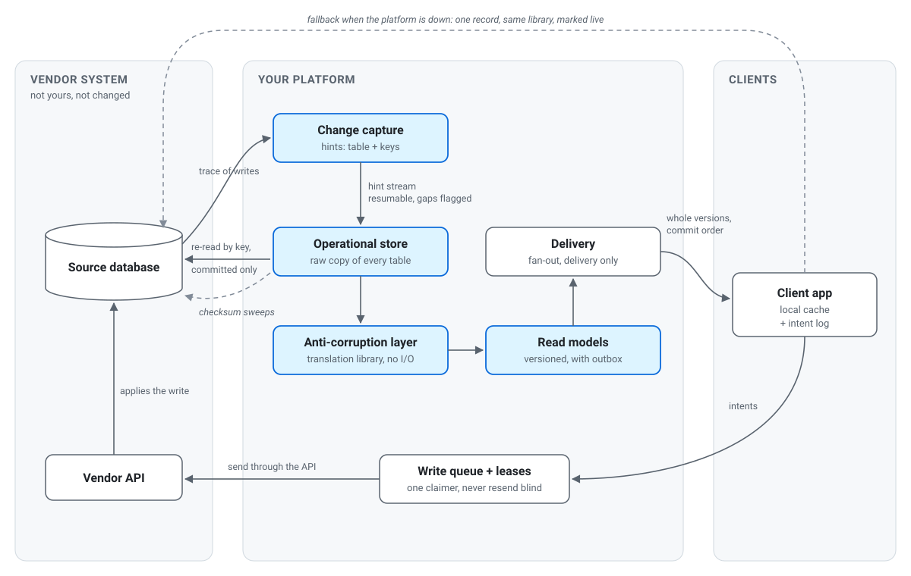

  <picture>
    <source media="(prefers-color-scheme: dark)" srcset="docs/orca-mark-dark.svg">
    
  </picture>

# ORCA: Operational store, Read models, Change capture, Anti-corruption layer

ORCA is an architectural pattern for building a fast, independent application platform on top of a system you do not
own and cannot change. It is not a stack: any language, database or message bus can implement it.

Version 1.0.

## The problem

Many organizations run their core business on a vendor's system: a practice-management, ERP or line-of-business
product whose database you can read but whose schema, release cycle and API belong to someone else. Over the years
everything else grows around it:

- **Direct reads:** dozens of internal tools query the vendor's database directly, each with its own polling loop.
- **Private copies:** each tool keeps its own partial copy, drifting slightly differently.
- **Leaking quirks:** the vendor's model (packed flag bytes, coded columns that need lookups, one table doing several
  jobs) leaks into every one of them.
- **Slow, incomplete API:** it is too slow and too incomplete to build on, and changing it is not an option.

The usual answers do not fit:

- **Rebuild on the vendor's API:** it lacks the reads you need.
- **Replace the vendor:** out of scope.
- **Turn on the database's own change tracking:** that alters a schema you do not own.
- **Mirror the database:** you get speed, but every app still speaks the vendor's model.

ORCA is the shape that remains: own a translated, live copy for reads, and send every write back through the vendor.

## At a glance

<picture>
  <source media="(prefers-color-scheme: dark)" srcset="docs/orca-overview-dark.svg">
  
</picture>

Reads flow left to right and never touch the vendor except through re-reads, sweeps and a narrow fallback. Writes
flow through the vendor's own API and are judged by what change capture brings back.

## The four parts

### Change capture
A low-latency, best-effort signal of which records changed, taken from outside the vendor's schema. Examples are a
database trace session, a transaction-log reader, or network capture of the vendor's client traffic.

- **Hints, not facts.** A capture record says "look at this table, these keys". It never says what the new values
  are. It may arrive before the change commits, may describe a change that later rolls back, and may be missing
  entirely.
- **Resumable, with gaps marked.** The stream has a position. A consumer reconnects from its last position and is told
  explicitly when records may have been lost (a gap).

### Operational store
Your own full copy of the vendor's data, kept current.

- **First copy:** resumable and paced, in key order, so the vendor's system never feels it.
- **Re-read on every hint:** the touched rows are re-read from the source by primary key, with a read that only sees
  committed data. A rolled-back change re-reads as the original. The hint only decides where to look; the source
  decides the truth.
- **Reconciliation:** checksums compared by key range, re-copying only ranges that differ. It runs after every gap,
  as soon as each table's first copy finishes, and on a slow schedule. Reconciliation always wins over the copy and
  over the stream.
- **A raw layer:** the vendor's tables kept exactly as they are, so translations can be rebuilt without touching the
  vendor again.

### Anti-corruption layer
A translation library that turns the vendor's model into yours: decoding packed values, resolving codes, splitting
tables that do several jobs, and joining what always belongs together.

- **Source-agnostic:** it takes plain rows and returns your shapes, so it doesn't care whether the rows came from your
  store or straight from the vendor.
- **One copy of the vendor's quirks:** everything else in the platform only sees your model.

### Read models
Screen-shaped documents built by the translation layer from the raw layer, such as an order header, a notes log or a
list row.

- **Versioned in commit order.** Each change gets a version, and version order must equal commit order. A plain
  sequence is not enough, because sequence values are handed out before commit. A single counter row updated inside
  each shaping transaction serializes them.
- **Outbox.** Each shaping transaction also writes its changes to an outbox table: the durable record every delivery
  reads from.
- **Whole versions only.** One version can cover several read models. Delivery never splits a version, and a consumer
  applies a whole version and only then saves its position.

## Around the four parts

### Delivery
A fan-out layer (a pub/sub cache, a websocket service) carries committed versions from the outbox to everyone
listening. It is delivery only, never the record: anything it loses is recovered from the outbox by position.

### Clients
- **Local cache:** clients can keep their own embedded copy of the read models they need (for example open records plus
  a recent window), fed by the delivery layer and resumed by version.
- **Fallback:** when the platform is unavailable, a client may run the same translation library directly against the
  source. That fallback must be narrow (the one record on screen, rate-limited, clearly marked as live) so an outage of
  your platform never becomes a flood of reads on the vendor's.

### Writes
Nothing writes to the vendor's database directly. Every write goes through the vendor's own API.

- **Intents first.** A client records the user's intent in a durable local log, shows it at once, and can offer a short
  undo window.
- **One claimer per intent.** A queue (e.g. `FOR UPDATE SKIP LOCKED`) ensures each intent has one claimer, in order per
  record. That is not exactly-once delivery: a worker can send and then crash before recording it.
- **Never resend blind.** An uncertain outcome is resolved by observation, never by sending again.
- **Judged by what comes back.** A write is judged by what returns through change capture, with three outcomes:
  - **Confirmed:** tied to this operation. For a create, the API returns the new record's ID and that exact record
    arrives.
  - **State reached:** the record holds the values sent, after the intent was sent, but nothing proves this request
    caused it. Enough for plain "set this field" changes.
  - **Undetermined:** the evidence cannot tell. Never retried automatically; shown to the person.

  Anything with side effects (creating records, sending, billing) only counts when Confirmed.
- **Leases with fencing tokens coordinate your own writers.** They are checked when an intent is queued and again
  before it is sent. They cannot recall a request already in flight, and they mean nothing to people working directly
  in the vendor's application. Conflicts with those people are detected afterwards through capture, not prevented.
  The vendor's own record locks, if visible, are mirrored in as a warning.

## Guarantees and non-guarantees

| ORCA guarantees | ORCA does not guarantee |
|---|---|
| Every committed source change eventually appears in the store (reconciliation) | That every change is seen through capture |
| The store never keeps a rolled-back value past the next re-read or reconciliation | That reads are as fresh as the source at every instant |
| Version order equals commit order; no consumer skips a committed version | Exactly-once delivery of writes to the vendor |
| A write is only reported done with evidence, and side-effecting writes only when Confirmed | That a write's cause can always be proved (Undetermined exists) |
| The vendor's model never leaks past the translation layer | Coordination with people using the vendor's application directly |

## Failure cases

| Situation | What happens |
|---|---|
| Capture misses a change (trigger writes, unparsable statements) | Reconciliation finds the differing range and re-copies it |
| Capture reports a gap | The consumer requests reconciliation of everything the gap could cover |
| A change rolls back after its hint | The committed-only re-read returns the original values |
| The first copy races a change | Each table counts as correct only after its first reconciliation |
| A worker crashes after sending a write | The intent is resolved by observation; it is never resent blind |
| A client reconnects after its position has expired | Full resync of its read models, not a replay |
| The platform is down | Clients fall back narrowly to the source, visibly |
| The vendor changes its schema | The raw layer shows it; translations are rebuilt from the raw layer |

## A worked example

One order, followed through the system. "Order 42" is any record in the vendor's database.

**The ordinary path.** The user sees the change at once, from their own intent log. The vendor's API applies it.
Capture says only "orders, key 42". The store re-reads that one row with a committed-only read, rebuilds the read
models for order 42 in one transaction that takes version 1001 and writes it to the outbox, and every client receives
version 1001 as a whole. The intent compares what came back with what it sent: the values match and arrived after the
intent was sent, so it is judged "state reached". For a create, the API's returned ID would make it "confirmed".

**The same order, when things go wrong:**

- **Capture loses the event.** Nothing arrives for order 42. The intent waits; after its timeout the store re-reads
  order 42 directly, and the next checksum sweep would find the range anyway. The intent then resolves on what it
  sees, never by sending again.

- **The change rolls back.** Capture still reports "orders, key 42", because the statement ran. The committed-only
  re-read returns the old values, nothing changes, and no version is issued. The intent sees its values never
  arrived and ends "undetermined", shown to the user.

- **The sending worker crashes after the API call.** Another worker claims the intent. Its outcome is uncertain, so it
  checks the store before doing anything. Order 42 already shows the change, so the intent is judged on that, and the
  vendor is never called twice.

- **Someone edits order 42 in the vendor's own application at the same moment.** Their change arrives through
  capture like any other. If it set the same values, the intent can only say "state reached", because nothing proves
  which request caused it. If it set different values, the intent ends "undetermined" and the user sees the conflict.

- **A client was offline overnight.** It reconnects from its last version. If the outbox still holds everything after
  that version, it receives whole versions in order; if not, it resynchronizes its read models instead of replaying.

<picture>
  <source media="(prefers-color-scheme: dark)" srcset="docs/orca-examples-dark.svg">
  
</picture>

## Related patterns

ORCA is assembled from known ideas. What it adds is how they are held together when the source is someone else's.

| Pattern | What ORCA takes | What ORCA changes |
|---|---|---|
| Change data capture (CDC) | A stream of what changed, consumed from a position | Capture is only a hint; truth comes from a committed-only re-read, and gaps are expected and reconciled. No log access or schema change is needed. |
| Operational data store | A live, current copy for reads | A raw layer kept exactly as the source, so translations rebuild without touching the vendor |
| Anti-corruption layer (domain-driven design) | Translate the outside model at the boundary | The translator is a library with no I/O, shared by the store and by clients' direct-to-source fallback, so the vendor's model has one home |
| CQRS read models | Read-shaped data, separate from where writes go | Writes don't go to your store at all: they go through the vendor's API and are judged by what comes back |
| Transactional outbox | Durable record of changes, written with the data | Versions are in commit order through a counter row, and delivered as whole groups so a consumer cannot skip part of one |
| Idempotent receivers / exactly-once | Avoiding duplicate effects | Replaced by honesty: one claimer, never resend blind, and three outcomes (confirmed, state reached, undetermined) |
| Leases with fencing tokens | Coordinating concurrent writers | Checked at enqueue and before send; explicitly not a guarantee against requests already in flight or people in the vendor's own application |

The combination is the point. A CDC pipeline usually assumes trustworthy capture and owned targets. CQRS usually
assumes you own the write side. ORCA assumes neither, and says exactly which guarantees survive.

## When ORCA fits

**It fits when:**
- many tools depend on a system you do not control;
- reads vastly outnumber writes;
- the vendor's model is awkward;
- the vendor's API is incomplete;
- you cannot or will not alter the vendor's schema.

**It doesn't fit:**
- if you own the source (use its own change tracking and build read models directly);
- if a few direct queries are enough;
- if every write needs synchronous confirmation from the vendor in the user's path.

## Implementing it

**What one implementation used:**
- **Capture:** a SQL Server Extended Events session filtered to insert, update and delete, read by a small service
  next to the database.
- **Store and read models:** a Rust service with PostgreSQL holding the raw layer, the read models, the outbox, the
  write queue and the leases.
- **Delivery:** Redis for fan-out.
- **Clients:** LMDB caches.

**Any equivalent works:** log-based capture such as Debezium, another database, Kafka for delivery, or SQLite on
clients.

## License

The text and diagrams are licensed under [Creative Commons Attribution 4.0](LICENSE). Use them, adapt them, build on
them; credit Nathan Curtis and link back here. To cite ORCA, use the "Cite this repository" button on GitHub or the
details in [CITATION.cff](CITATION.cff).
